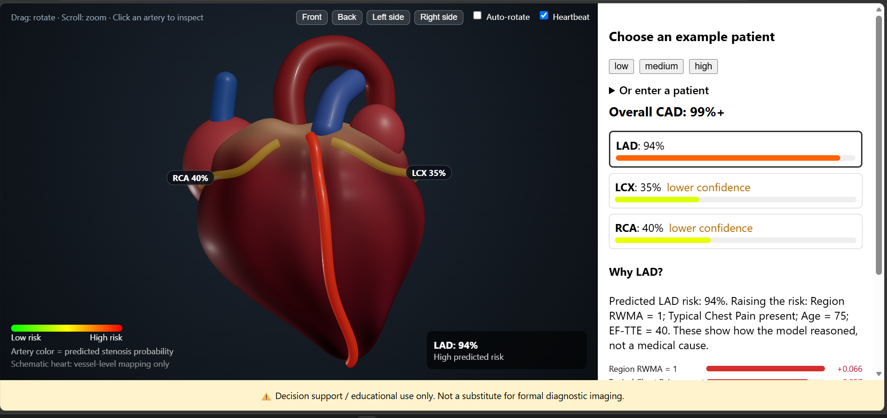
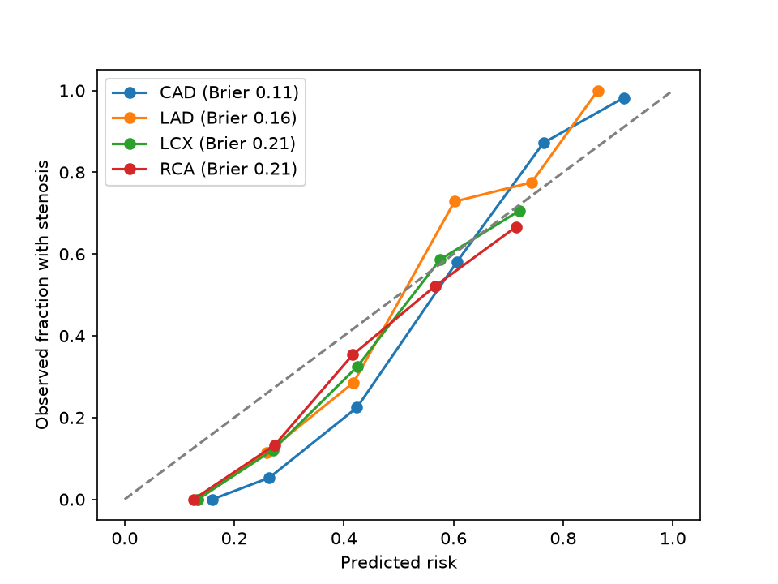

# Cardiac Risk Visualizer
### by Team ZYRA: Amal Princy J and Govarthini K


**Explainable coronary artery disease risk, shown on an interactive 3D heart.**

Most risk models give you a number. We built one that shows *where* the risk is, explains *why* the model said it, and tells you honestly *how far to trust it*.

> **Decision support / educational use only. Not a substitute for formal diagnostic imaging.**



---

## Why this project is different

| What we did | Why it matters |
|---|---|
| **Leakage-safe by design** | `LAD`, `LCX`, `RCA` and `Cath` are removed from every model's inputs, exactly as the dataset authors advise. Many CAD models quietly cheat with these columns. Ours do not. |
| **Four models, one clear view** | Separate models for overall CAD and for each artery (LAD, LCX, RCA), shown together on one heart. |
| **Explanations for every prediction** | SHAP bars show which factors raised (red) or lowered (blue) the risk for that patient. |
| **Honest evaluation** | Repeated stratified cross-validation, calibration curves and Brier scores. We publish where the models are weak, not only where they are strong. |
| **Built for people, not just metrics** | Pick an example patient, rotate the heart, click an artery, read the reasons. A model performance and limitations panel is built into the app. |

---

## Results at a glance

Cross-validated on 303 patients (stratified 5-fold, 3 repeats):

| Target | AUC | Recall | Precision | F1 | Accuracy |
|---|---|---|---|---|---|
| **CAD** | **0.92** | 0.95 | 0.88 | 0.92 | 0.87 |
| LAD | 0.85 | 0.88 | 0.79 | 0.83 | 0.79 |
| LCX | 0.72 | 0.60 | 0.59 | 0.60 | 0.68 |
| RCA | 0.72 | 0.56 | 0.56 | 0.55 | 0.67 |

**Calibration (Brier score, lower is better):** CAD 0.11, LAD 0.16, LCX 0.21, RCA 0.21.

- The CAD model finds 95 of every 100 true CAD cases and is the best calibrated.
- LAD is solid. LCX and RCA are weaker, and the app says so openly.



---

## Leakage prevention (important)

To prevent target leakage, the columns **`LAD`, `LCX`, `RCA` and `Cath`** are **excluded from all model inputs**. They are the labels the models predict, or come directly from the angiography that produced them, so using them as inputs would make the models look accurate while learning nothing.

The dataset authors give the same advice: only one of LAD, LCX, RCA or Cath may be used, and the others must be removed. We remove all four. All four models share the same input table, and the `/features` endpoint lists the inputs actually used.

---

## Features
- 3D heart where artery colour = predicted stenosis probability (green = low risk, red = high risk)
- Example patients (low, medium, high) and a form to enter your own
- Click an artery to inspect its predicted risk and top contributing factors
- SHAP bars: red raises the risk, blue lowers it
- Overall CAD probability pinned at the top of the panel
- Heartbeat animation, camera presets (front, back, left, right) and auto-rotate
- "Model performance & limitations" panel with cross-validated metrics (written by `notebooks/01_explore_data.ipynb` into `metrics.json`)

## Tech stack
| Part | Tools |
|---|---|
| Models | Python, scikit-learn (Random Forest), SHAP |
| Backend | FastAPI, Uvicorn |
| Frontend | React, Vite, Three.js (react-three-fiber) |
| Analysis | Jupyter (`notebooks/01_explore_data.ipynb`) |

## Project structure
```
backend/     FastAPI app (main.py), training script (train.py), saved_models/
frontend/    React + Vite app
notebooks/   Data exploration, metrics, calibration
data/        Dataset files and calibration.png
docs/        Screenshots
requirements.txt
LICENSE
```

## How to run

### 1. Backend

**Windows**
```
python -m venv venv
venv\Scripts\activate
pip install -r requirements.txt
cd backend
uvicorn main:app --reload
```

**macOS / Linux**
```
python3 -m venv venv
source venv/bin/activate
pip install -r requirements.txt
cd backend
uvicorn main:app --reload
```
Runs at http://127.0.0.1:8000. Useful endpoints: `/features`, `/metrics`.

### 2. Frontend (new terminal)
```
cd frontend
npm install
npm run dev
```
Open http://localhost:5173.

### 3. Metrics file
The metrics panel reads `metrics.json`, written by the metrics cell in `notebooks/01_explore_data.ipynb`. Run that cell once, then restart the backend.

---

## Limitations (we state them on purpose)
- Trained on 303 patients from a single dataset; performance on other populations is unknown.
- LCX and RCA predictions are much weaker than CAD and LAD (AUC 0.72 vs 0.92).
- CAD overestimates risk in the middle probability range.
- Overall CAD is a separate model, so it can occasionally come out lower than a vessel prediction.
- Vessel-level mapping on a schematic heart, not a patient scan.
- SHAP explanations show how the model reasoned, not medical causes.
- Example patients come from the training data, so their risks look optimistic.
- Not validated on external or prospective data.

---

## Dataset
*Extension of Z-Alizadeh Sani Dataset*, UCI Machine Learning Repository (303 patients). Licensed under CC BY 4.0.

https://archive.ics.uci.edu/dataset/411/extention+of+z+alizadeh+sani+dataset

Citation: Alizadehsani, R., Roshanzamir, M., & Sani, Z. (2013). *extention of Z-Alizadeh sani dataset* [Dataset]. UCI Machine Learning Repository. https://doi.org/10.24432/C5461K

## Attributions
- Dataset: UCI Machine Learning Repository (above)
- Explainability: SHAP (Lundberg & Lee, 2017)
- 3D visualisation: Three.js

## Future work
- Validate on an external cohort
- Improve LCX and RCA with more data and other models
- Link predictions to real imaging

## Demo
Demo video: link to be added before submission.


## Report
[Technical report (PDF)](docs/report.pdf)


## Team ZYRA

| Name | Role |
|---|---|
| Amal Princy J | Dataset and models, backend, 3D visualisation, report and documentation |
| Govarthini K | Demo video recording and editing |
| Hemalatha G | Demo video voice-over |

Built by Team ZYRA.


## License
Code is released under the MIT License (see `LICENSE`). Copyright (c) 2026 Team ZYRA. The dataset keeps its own CC BY 4.0 license.

## Disclaimer
This project is for learning and demonstration only. It must not be used for diagnosis or treatment decisions.